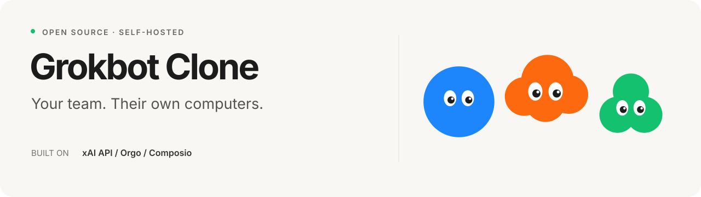

<p align="center">
  
</p>

<p align="center">
  An open-source take on always-on AI teammates, with computer use, connected apps, memory, and voice.<br>
  Built on xAI's public Grok API, Orgo cloud computers, and Composio.
</p>

<p align="center">
  <a href="#quick-start">Quick start</a> ·
  <a href="#what-you-can-do">Features</a> ·
  <a href="docs/ARCHITECTURE.md">Architecture</a> ·
  <a href="#development">Development</a> ·
  <a href="SECURITY.md">Security</a> ·
  <a href="https://github.com/nickvasilescu/orgo-teammates/issues">Issues</a>
</p>

> Independent, unofficial open-source project. Not affiliated with or endorsed by xAI or any other company named here. See the [disclaimer](#disclaimer).

---

Give a Bot a job, connect the apps it needs, and follow its work in chat. Each Bot has a name, a look, its own memory, and a desktop you can watch or take over. Bots can work together, run recurring tasks, and talk with you over voice.

Orgo Teammates is a self-hosted runtime for these AI teammates that you can run and modify yourself. You bring your own API keys; conversations, settings, and agent state live in a local SQLite database.

## What you can do

- **Give every Bot a role.** Set its instructions, appearance, thinking effort, skills, and memories. Make one your primary point of contact.
- **Put it to work on a computer.** Bots browse websites, run shell commands, and use a full Linux desktop through Orgo. Watch live, take control, and find saved work in the Library.
- **Connect your apps.** Google sign-in and app connections run through Composio. Read actions run automatically; Composio write actions pause for approval, with an option to remember your choice.
- **Build a team.** Bots delegate work, start subagents, and join group chats with @mentions.
- **Keep work moving.** Schedule routines, react to app events, and have your primary Bot send check-ins at times you choose.
- **Keep context.** Bots retain durable memories, recall earlier facts, and compact long conversations.
- **Talk it through.** Realtime voice calls hand tasks to the same Bot runtime. Voice selection, speed, previews, and push-to-talk dictation are included.

Each user's Bots share one Orgo VM, with up to four separate Bot desktops active at once. Idle computers can sleep and wake when needed.

## Quick start

### 1. Get the project

Install **Node.js 22.22 or newer**, then:

```bash
git clone https://github.com/nickvasilescu/orgo-teammates.git
cd orgo-teammates
npm ci
cp .env.example .env
```

### 2. Configure your keys

Fill in these values in `.env`:

| Variable | Purpose |
| --- | --- |
| `XAI_API_KEY` | Grok text and voice API access |
| `COMPOSIO_API_KEY` | App connections, tool catalog, and Google sign-in |
| `ORGO_API_KEY` | Cloud computer access |
| `ORGO_WORKSPACE_ID` | Workspace in which to create computers |
| `SESSION_SECRET` | Secret used to sign sessions |

Generate a session secret with:

```bash
openssl rand -hex 32
```

Paste the result into `SESSION_SECRET`. The example environment file includes the local URLs, computer size, and optional voice settings. The default text model is `grok-4.7`; change `XAI_MODEL` to use another compatible model available to your account.

Keys stay on the server. Set spend limits with each provider, and never show `.env` or a provider dashboard on screen or in a recording. See [Deploying safely](SECURITY.md#deploying-safely).

### 3. Start the app

Run the API in one terminal:

```bash
npm run dev -w server
```

Run the frontend in a second terminal:

```bash
npm run dev -w web
```

Open **[localhost:5173](http://localhost:5173)**. The frontend proxies API requests to port `8787`.

Use **Sign in with Google**, or use the local email form with `DEV_LOGIN=1` (enabled in `.env.example`). Your account starts with a primary Bot. Create another Bot, give it a role, and send it a task.

The first computer task provisions an Orgo VM. Model calls, app actions, and computers use your provider accounts and may incur charges.

### Run a built version

```bash
npm run build
npm start
```

The API serves the built app at **[localhost:8787](http://localhost:8787)**. Set both `APP_URL` and `SERVER_URL` to that address, or to your public HTTPS URL when hosting it, so sign-in redirects return to the right place.

The server listens on `127.0.0.1` by default. Before you expose it to anyone else, read [SECURITY.md](SECURITY.md):

- `HOST` sets the listen address. Only use `0.0.0.0` behind authentication and HTTPS.
- `DEV_LOGIN` lets anyone sign in as any email, so the server ignores it unless `HOST` and `SERVER_URL` are both localhost.
- `ALLOWED_EMAILS` (comma-separated emails or `@domain` entries) controls who can create an account. On a non-localhost `SERVER_URL`, new sign-ups are refused until you set it, because every account spends your API credits.

## How it works

| Layer | Implementation |
| --- | --- |
| Web app | React, TypeScript, Vite, and Zustand |
| Server | Node.js, Hono, SQLite, and Server-Sent Events |
| Agent runtime | Grok Responses API with streaming, tools, memory, and approval handling |
| Computers | Orgo VM lifecycle and per-Bot desktops; noVNC viewer through a server-side relay |
| Connected apps | Composio catalog, sessions, authentication, tools, and triggers |
| Voice | Grok realtime sessions with a relay into the text agent's task loop |

The server owns the agent loop. It builds context, streams a model response, executes tools, pauses for approvals when required, and continues until the task is done. Voice hands work to that same loop.

For the details, read the [architecture guide](docs/ARCHITECTURE.md), [Orgo integration guide](docs/orgo-builder-guide.md), and [Grok and Composio integration guide](docs/xai-and-composio.md).

## Development

```bash
npm run typecheck       # Check the server and frontend
npm run build           # Build both workspaces
```

The main source directories are:

```text
server/src/     API routes, agent runtime, tools, and integrations
web/src/        Chat, Bot settings, app connections, computer viewer, and voice
web/public/     Static UI assets
tests/          Playwright integration and voice scripts
docs/           Architecture and integration guides
```

### Integration tests

With the server running and `DEV_LOGIN=1`:

```bash
node tests/e2e.mjs http://localhost:8787
```

The suite creates a temporary Bot and exercises chat, computer tools, the live viewer, search, app connections, voice sessions, groups, and settings. Set `E2E_EMAIL` to choose the test account. It calls real providers and requires Google Chrome at `/usr/bin/google-chrome`.

The separate `tests/voice-call.mjs` script is a development harness for two-way audio. It assumes Google Chrome at `/usr/bin/google-chrome` and a prepared audio file, so adapt it before use on another system.

### Contributing

Bug reports, improvements, and pull requests are welcome. For a bug, include the steps to reproduce, expected behavior, Node version, and relevant logs with secrets removed. For larger changes, open an [issue](https://github.com/nickvasilescu/orgo-teammates/issues) first to discuss the approach.

Please report security problems privately as described in [SECURITY.md](SECURITY.md), not in issues or video comments.

Keep changes focused, run the typecheck and build, and describe how you verified the affected flow. Never commit API keys, `.env` files, databases, or screenshots containing personal information.

## Project status

This is an experimental project. The core workflows are implemented. It has had a basic security review, not a professional audit. Bots within an account share a VM; Composio write approvals do not cover every possible action a Bot can take through its browser or shell.

Planned work includes a faster executor inside each VM, file-based skills and task recording, a local-computer companion, and meeting support.

Configuration options for idle suspension, memory consolidation, and history compaction are described in the [architecture guide](docs/ARCHITECTURE.md#configuration). Start with [`.env.example`](.env.example) for connection settings.

## Upgrading from grokbot-clone

This project was previously published as `grokbot-clone`. GitHub redirects the old repository URL, but you can point your clone at the new one:

```bash
git remote set-url origin https://github.com/nickvasilescu/orgo-teammates.git
```

Existing installs keep working without changes:

- **Environment variables.** `GROKBOT_*` variables (for example `GROKBOT_IDLE_SUSPEND_MIN` or `GROKBOT_API`) are still read when the matching `TEAMMATES_*` variable is unset. Rename them when convenient.
- **Database.** If `data/grokbot.db` exists and `data/teammates.db` does not, the server keeps using `data/grokbot.db`. To switch, stop the server and rename `data/grokbot.db` (plus any `-wal` and `-shm` files next to it) to `data/teammates.db`. `DB_PATH` still overrides both.
- **Sign-in.** Existing sessions stay valid; the old session cookie is still accepted.
- **Computers.** On computers created before the rename, `/root/teammates` is linked to the existing `/root/grokbot` directory, so Library files and browser profiles carry over.
- **Exposure defaults.** The server now listens on `127.0.0.1` unless `HOST` is set, ignores `DEV_LOGIN` on non-local servers, and refuses new sign-ups on a public `SERVER_URL` until `ALLOWED_EMAILS` is set. Existing accounts can still sign in.

## License and credits

Project code is available under the [MIT license](LICENSE). Open-source dependencies and other third-party notices are listed in [THIRD_PARTY_NOTICES.md](THIRD_PARTY_NOTICES.md).

Built with [xAI's Grok API](https://x.ai/api), [Orgo](https://orgo.ai), and [Composio](https://composio.dev).

## Disclaimer

Orgo Teammates is an independent, unofficial open-source project. It is not affiliated with, endorsed by, or sponsored by xAI, X Corp, SpaceX, Anysphere (Cursor), or any other company named in this repository. Grok and Grok Bot are trademarks of their respective owners and are mentioned only to describe compatibility with xAI's public API. The same applies to every other third-party name, product, and logo referenced in this repository, including app logos shown at runtime through Composio.

The project was written from scratch. It contains no code, assets, prompts, or other material taken from xAI's products. It talks only to public APIs, using your own keys.

This software is educational and experimental. It is provided "as is", without warranty of any kind, under the terms of the [MIT license](LICENSE).

You are responsible for your own API keys and any costs they incur, for complying with the terms of service of every third-party provider you connect (including xAI, Orgo, Composio, and the apps you link) and with applicable law, and for supervising Bots that act on real accounts, devices, or data.
